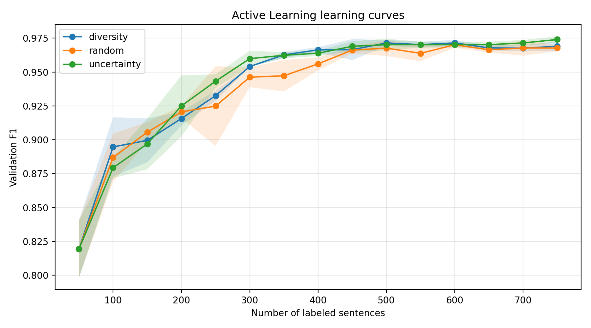

# French Source-Reference Detection with CamemBERT

**Sentence-level classification · Transformer fine-tuning · Active learning · Annotation efficiency**

This project investigates whether French parliamentary sentences contain a reference to an information source. It combines (1) a supervised CamemBERT classifier trained on the complete training split and (2) a controlled comparison of active learning strategies designed to reduce the amount of labeled data required. The original course project and dataset were developed in the context of **DAPEPANE**; the active learning experiments extend that work.

## 1. Key challenges

**Limited annotated data.** The corpus contains just **1,790 annotated sentences**: 1,500 for training, 200 for validation and only 90 for testing. The relatively small dataset limits both the amount of supervision available to the classifier and the precision of its evaluation.

**Small evaluation set.** With only 90 test sentences, each additional error changes accuracy by approximately **1.1 percentage points**. Strong scores on this split should therefore not be treated as definitive evidence of generalization to other parliamentary texts or domains.

**Annotation efficiency.** Obtaining linguistic annotations can be time-consuming. The second part of this project investigates whether selecting examples strategically can maintain classification performance while using fewer labeled sentences. It evaluates annotation efficiency, not necessarily computational efficiency.

## 2. Problem definition

**Input:** a French parliamentary sentence. **Output:** `1` if the sentence contains at least one annotated source reference, otherwise `0`.

The original annotations are token-level tags. For this experiment they are converted to a binary sentence label:

```python
label = int(any(tag != "O" for tag in labels))
```

The goal is **source-reference presence detection**, not extraction of the exact reference span (NER/sequence labeling). This distinction matters when interpreting the evaluation: the classifier can identify a sentence containing a reference without locating the referenced words.

### Dataset

| Split | Sentences | Positive (1) | Negative (0) | Positive share |
|---|---:|---:|---:|---:|
| Train | 1,500 | 958 | 542 | 63.9% |
| Validation | 200 | 128 | 72 | 64.0% |
| Test | 90 | 57 | 33 | 63.3% |

The data are stored as JSON Lines (one JSON object per line) in `data/train.json`, `data/valid.json`, and `data/test.json`. The validation set is used for model/threshold selection; the test set is reserved for final evaluation.

## 3. Part I — Supervised CamemBERT classification

### Model and training decisions

- **Backbone:** `camembert-base`, a French-language pretrained Transformer. Fine-tuning adapts its contextual representations to the binary classification task.
- **Class-weighted cross-entropy:** accounts for the moderate imbalance between source-containing and source-free sentences. Weights are calculated from the training split.
- **Learning rate:** `2e-5`; **batch size:** `16`; **maximum sequence length:** `256` tokens; **maximum epochs:** `5`; **seed:** `42`.
- **Checkpoint selection:** the best epoch is selected by validation F1 rather than by training loss alone.
- **Decision threshold:** instead of assuming `0.50`, positive-class probability thresholds from `0.30` to `0.90` (increments of `0.05`) are evaluated on validation data. The chosen threshold is then applied unchanged to the test set.

The checkpoint and threshold are both selected using validation data; test labels do not inform either decision.

### Validation threshold analysis

| Threshold range | Validation F1 |
|---|---:|
| 0.30–0.80 (steps of 0.05) | 0.9653 |
| **0.85** | **0.9690** |
| 0.90 | 0.9690 |

**Selected threshold: 0.85.** The best validation F1 is tied at 0.85 and 0.90; the threshold-selection routine retains the first maximum. The nearly constant F1 across much of the range indicates that the predictions are relatively insensitive to threshold changes in that interval; it does **not** establish probability calibration.

### Held-out test results

| Metric | Value |
|---|---:|
| **Positive-class F1** | **0.9735** |
| Accuracy | 0.9667 |
| Precision, class 1 | 0.9821 |
| Recall, class 1 | 0.9649 |
| Test sentences | 90 |
| Decision threshold | 0.85 |

**Classification report** (rounded as in the original experiment):

| Class | Precision | Recall | F1-score | Support |
|---|---:|---:|---:|---:|
| 0 — No reference | 0.94 | 0.97 | 0.96 | 33 |
| 1 — Reference | 0.98 | 0.96 | 0.97 | 57 |
| Macro average | 0.96 | 0.97 | 0.96 | 90 |
| Weighted average | 0.97 | 0.97 | 0.97 | 90 |

**Confusion matrix** (rows: true labels; columns: predicted labels):

| | Predicted 0 | Predicted 1 |
|---|---:|---:|
| **True 0** | 32 | 1 |
| **True 1** | 2 | 55 |

The classifier correctly identifies **55 of 57** source-containing sentences and **32 of 33** sentences without a source reference. The three errors comprise **one false positive** and **two false negatives**. This is strong performance on this held-out split, but the small test set means that individual mistakes noticeably affect the reported metrics.

**Interpretation:** the tuned threshold favors high precision on the positive class while maintaining high recall. The threshold was optimized for F1 on validation, not explicitly for precision; the observed precision/recall balance is a result of the trained model and chosen threshold.

Script: [`source_reference_classification.py`](source_reference_classification.py).

## 4. Part II — Active learning

### Motivation and experimental question

A central constraint of this project is the **limited availability of annotated linguistic data**. The corpus contains only 1,790 sentences, including a particularly small test set of 90 examples. Although the supervised CamemBERT model achieves a test F1 of **0.9735**, this score must be interpreted cautiously because a few predictions have a substantial impact on the reported metrics.

This motivates a second, related question: **Can we achieve comparable classification performance while labeling substantially fewer training examples?**

To investigate this question, we simulate an active learning workflow that begins with 50 labeled examples and progressively selects additional sentences from the remaining training pool. We compare random sampling, uncertainty sampling, and diversity-constrained uncertainty sampling at identical annotation budgets. The goal is to understand whether informed example selection can reduce annotation requirements in a data-constrained NLP setting.

The limited test set is a constraint of the available corpus, not a consequence of active learning itself. Active learning addresses the **training annotation budget**; it does not solve the need for a larger independent evaluation set.

### Active learning workflow

1. Start with a stratified labeled subset of **50 sentences**.
2. Fine-tune CamemBERT using the currently labeled subset and select the best validation checkpoint.
3. Score the remaining unlabeled training sentences according to the acquisition strategy.
4. Select **50 additional sentences** and reveal their existing labels (simulated annotation).
5. Repeat training and selection until the labeled pool reaches **750 sentences**.

The simulation uses the annotations already available in the corpus: no new human annotation was carried out during these experiments.

### Acquisition strategies

1. **Random:** randomly select unlabeled sentences; a reference point for assessing whether informed acquisition helps.
2. **Uncertainty:** choose sentences whose predicted positive-class probabilities are closest to `0.5`, where the model is least confident under this binary probability criterion.
3. **Diversity + uncertainty:** compute contextual sentence representations from the model's first-token hidden state, partition the unlabeled pool into `k` clusters using **KMeans**, and select the most uncertain sentence from each cluster. Here `k` equals the number of examples acquired in that round. This aims to avoid spending the entire annotation budget on similar uncertain examples.

The diversity strategy is **cluster-constrained uncertainty sampling**, not pure diversity sampling. Representations are extracted from the current fine-tuned model, so the selected examples can change as training progresses.

### Experimental protocol

| Setting | Value |
|---|---|
| Initial labeled pool | 50 sentences, stratified by class |
| Acquisition batch | 50 sentences per round |
| Maximum labeled budget | 750 sentences (50% of training split) |
| Strategies | Random, uncertainty, diversity + uncertainty |
| Random seeds | 42, 123, 2026 |
| Model | `camembert-base` |
| Training per budget | Up to 5 epochs; best validation checkpoint |
| Training loss | Class-weighted cross-entropy |
| Threshold | Selected on validation for each trained model |
| Learning curves | Validation F1 versus labeled budget |
| Final comparison | Held-out test F1 at 750 labels |

All methods operate on the same training pool and are assessed on the same fixed validation/test splits. The iterative procedure simulates annotation using labels already present in the dataset; it does not involve a human annotator during acquisition.

### Learning curves (validation)



The graph shows **validation F1**, averaged across three seeds; it is not a plot of test-set performance. Detailed observations for each seed, strategy and budget are recorded in [`results/results.csv`](results/results.csv), and aggregate mean/standard deviation values are in [`results/summary.csv`](results/summary.csv).

At the final budget of 750 labeled examples:

| Strategy | Mean validation F1 (3 seeds) |
|---|---:|
| Random | 0.9677 |
| Uncertainty | **0.9740** |
| Diversity + uncertainty | 0.9690 |

**Validation and test rankings differ:** uncertainty has the highest mean validation F1 at the final budget, whereas diversity + uncertainty has the highest mean test F1. These metrics should not be conflated.

### Final held-out test comparison (750 labels)

| Seed | Random F1 | Uncertainty F1 | Diversity + uncertainty F1 |
|---|---:|---:|---:|
| 42 | 0.9643 | 0.9636 | **0.9821** |
| 123 | 0.9636 | **0.9730** | **0.9730** |
| 2026 | 0.9643 | 0.9636 | **0.9730** |
| **Mean** | **0.9641** | **0.9667** | **0.9760** |

For context, the full-data supervised model achieved **0.9735 test F1 using 1,500 labeled training sentences**. The diversity + uncertainty strategy reached **0.9760 mean test F1 with 750 labeled sentences**, half the available training pool. This is an encouraging result for annotation efficiency, **not proof** that 750 labels are generally sufficient or that diversity sampling is statistically superior.

### Comparison with full-data training

| Approach | Labeled training sentences | Test F1 |
|---|---:|---:|
| Full-data supervised CamemBERT | 1,500 | 0.9735 |
| Random sampling (mean across 3 seeds) | 750 | 0.9641 |
| Uncertainty sampling (mean across 3 seeds) | 750 | 0.9667 |
| **Diversity + uncertainty (mean across 3 seeds)** | **750** | **0.9760** |

The diversity-constrained approach achieved a similar test score using **half of the training examples**, suggesting that annotation-efficient learning may be feasible for this task. The comparison is descriptive: the full-data result is one run, while the active learning figures are averages across three seeds.

### Interpretation and limitations

- **Annotation efficiency:** informed selection can yield competitive performance with fewer labeled sentences in this experiment. This does not imply a 50% reduction in total compute: active learning retrains models repeatedly and computes acquisition scores/embeddings.
- **Strategy trade-off:** uncertainty focuses on decision-boundary cases; clustering adds coverage of different representation-space regions. The diversity-based strategy performs best on average on this test set, but not on validation at the final budget.
- **Small evaluation set:** with only 90 test examples, one changed prediction affects accuracy by about **1.1 percentage points**. Small differences in F1 are fragile.
- **Limited repeated trials:** three random seeds provide an initial variability check, not a formal significance test.
- **Threshold selection:** thresholds are tuned on the same validation split repeatedly, potentially increasing dependence on this split.
- **Scope:** results apply to binary source-reference detection in this corpus; they do not establish span-level extraction quality or transfer to other domains.

Script: [`active_learning.py`](active_learning.py).

## 5. Repository layout

```text
.
├── data/
│   ├── train.json
│   ├── valid.json
│   └── test.json
├── results/
│   ├── results.csv
│   ├── summary.csv
│   ├── learning_curves.png
│   └── config.json
├── source_reference_classification.py
├── active_learning.py
├── requirements.txt
└── README.md
```

## 6. Installation and reproduction

Install dependencies in a suitable Python environment:

```bash
pip install -r requirements.txt
```

**Supervised model:**

```bash
python source_reference_classification.py --data-dir data --output-dir baseline_outputs
```

**Active learning comparison:**

```bash
python active_learning.py --data-dir data --output-dir al_outputs --final-test
```

A CUDA-capable GPU is recommended. The active learning experiment trains a new model for each budget, strategy and seed, and therefore requires substantially more GPU time than a single fine-tuning run. Reported results are from the original experimental runs; exact numerical reproduction can depend on library versions and hardware.

## 7. Acknowledgements

The original course project and dataset were developed within the framework of **DAPEPANE**. This repository presents the supervised classification component and an extension investigating active learning strategies for annotation-efficient source-reference detection.
